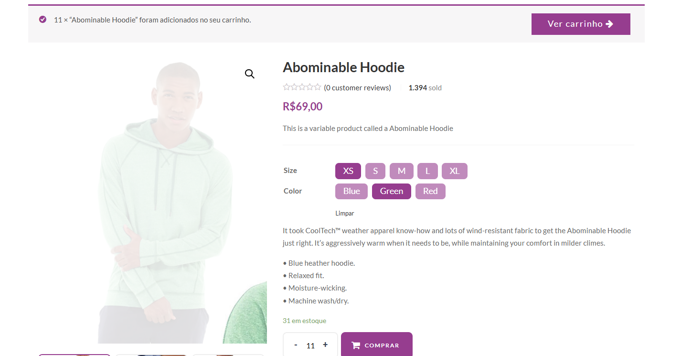

# BUG-002 — Carrinho aceita mais de 10 unidades do mesmo produto

| Campo | Valor |
|---|---|
| **ID** | BUG-002 |
| **História relacionada** | US-0001 — Adicionar item ao carrinho |
| **Caso de teste** | CT-003 — Não deve permitir adicionar mais de 10 unidades do mesmo produto |
| **Tipo** | Funcional (regra de negócio) |
| **Severidade** | Média |
| **Prioridade** | Alta |
| **Ambiente** | http://lojaebac.ebaconline.art.br — Chrome — Windows |
| **Detectado por** | Automação de UI (Cypress) e confirmado manualmente |
| **Status** | Aberto |

## Descrição

A regra de negócio da US-0001 determina que *"não é permitido inserir mais de 10 itens de um
mesmo produto ao carrinho"*. Porém, a loja permite adicionar 11 unidades do mesmo produto,
sem exibir nenhuma mensagem de erro.

## Pré-condições

- Carrinho vazio.
- Produto com estoque disponível na combinação de tamanho e cor escolhida.

## Passos para reproduzir

1. Acessar a página do produto "Abominable Hoodie"
2. Selecionar um tamanho e uma cor disponíveis
3. Informar a quantidade **11**
4. Clicar em "Comprar"
5. Acessar o carrinho

## Resultado esperado

O produto não é adicionado ao carrinho e é exibida uma mensagem informando o limite máximo de
10 unidades por produto.

## Resultado obtido

As 11 unidades são adicionadas ao carrinho, sem nenhuma mensagem de erro.

## Análise (valor limite)

| Quantidade | Esperado | Obtido |
|---|---|---|
| 10 | Aceita | Aceita ✅ (CT-002) |
| 11 | Recusa | Aceita ❌ (CT-003) |

O limite máximo não está implementado: o sistema aceita valores acima da fronteira definida
pela regra de negócio.

## Impacto

Descumprimento de regra de negócio definida pelo PO. A regra pode existir para controle de
estoque, para evitar compras para revenda ou para limitar fraudes. Além disso, a quantidade
também pode ser alterada diretamente no carrinho, ponto que deve ser verificado na correção.

## Sugestão de correção

Validar a quantidade máxima no servidor (e não apenas no campo de quantidade do navegador),
tanto ao adicionar o produto quanto ao atualizar a quantidade no carrinho. No WooCommerce,
isso pode ser feito pelos filtros `woocommerce_add_to_cart_validation` e
`woocommerce_update_cart_validation`.

## Evidência

