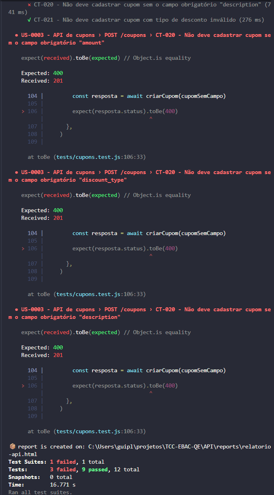

# BUG-003 — API de cupons aceita cadastro sem campos obrigatórios

| Campo | Valor |
|---|---|
| **ID** | BUG-003 |
| **História relacionada** | US-0003 — API de cupons |
| **Caso de teste** | CT-020 — Não deve cadastrar cupom sem campo obrigatório |
| **Tipo** | Funcional (regra de negócio) / API |
| **Base da expectativa** | Requisito explícito da US-0003 |
| **Classificação** | Defeito comprovado |
| **Severidade** | Média |
| **Prioridade** | Média |
| **Ambiente** | `POST http://lojaebac.ebaconline.art.br/wp-json/wc/v3/coupons` |
| **Detectado por** | Automação de API (Supertest + Jest) |
| **Status** | Aberto |

## Base do requisito

A obrigatoriedade dos campos está explícita nas regras de negócio da US-0003 (não é uma
premissa adotada pelo QE):

> "Deve cadastrar os cupons com os campos obrigatórios abaixo: Código do cupom, Valor, Tipo do
> desconto, Descrição [...] Os outros campos são opcionais."

## Descrição

A US-0003 define como **obrigatórios** os campos código (`code`), valor (`amount`), tipo do
desconto (`discount_type`) e descrição (`description`). A API, porém, só rejeita o cadastro
quando falta o `code`. Sem `amount`, `discount_type` ou `description`, o cupom é criado
normalmente (status 201), com valores padrão.

## Pré-condições

- Credenciais do administrador (autenticação Basic).

## Passos para reproduzir

1. Enviar `POST /wp-json/wc/v3/coupons` com autenticação Basic do administrador e o corpo
   abaixo (sem o campo `amount`):
   ```json
   {
     "code": "cupom_sem_valor_001",
     "discount_type": "fixed_product",
     "description": "Cupom de teste"
   }
   ```
2. Repetir removendo, um de cada vez, os campos `discount_type` e `description`.

## Resultado esperado

Status **400 Bad Request**, com mensagem indicando o campo obrigatório ausente. O cupom não
deve ser criado.

## Resultado obtido

Status **201 Created** nos três casos: o cupom é criado mesmo sem o campo obrigatório.

| Campo ausente | Esperado | Obtido |
|---|---|---|
| `code` | 400 | 400 ✅ |
| `amount` | 400 | 201 ❌ |
| `discount_type` | 400 | 201 ❌ |
| `description` | 400 | 201 ❌ |

## Impacto

Cupons incompletos podem ser cadastrados por engano, sem valor, sem tipo de desconto ou sem
descrição definidos por quem os criou, afetando campanhas promocionais e o cálculo de
descontos. Os valores atribuídos pela API aos campos ausentes não foram verificados neste teste.

## Sugestão de correção

Validar a presença dos quatro campos obrigatórios no serviço de cadastro de cupons e
retornar 400 com mensagem descritiva quando algum estiver ausente.

## Evidência


